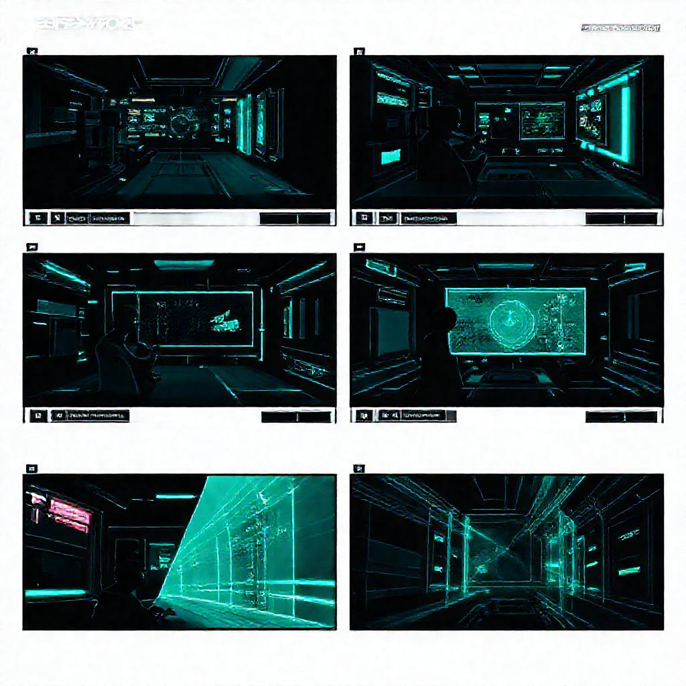

# Storyboard: Reverse Any Video (60s Tech Promo)

A 6-panel pre-production storyboard and visual breakdown generated with **DeepInfra FLUX-1-schnell** and calibrated to 60.0 seconds.

---

## Panel 1: Hook & The Promise (0:00 – 0:08)
- **Visual Image:** `seed/images/scene_1_hook.jpg`
- **Shot Type:** Medium close-up, high-energy A-roll with punch-in zoom (100% -> 108%).
- **Key Overlay:** Bold headline *"REVERSE-ENGINEER ANY EDIT"* with subtitle pill *"Target Video → Perfect Blueprint"*. At 0:02, comparison card enters on the right with glowing transfer lines.
- **Narration:** *"What if you could take ANY viral video, reverse-engineer every cut, color, and pacing decision, and turn it into a perfect blueprint in seconds?"*
- **Audio Cue:** Digital whoosh at 0:02.

---

## Panel 2: The Old Way vs. The New Way (0:08 – 0:18)
- **Visual Image:** `seed/images/scene_2_old_vs_new.jpg`
- **Shot Type:** 50/50 vertical split-screen wipe from left to right.
- **Key Overlay:** Left red chaotic raw JSON terminal logs (*"The Old Way: Raw & Unsimplified"*). Right emerald structured blueprint card with checkmarks (*"The New Way: AI-Ready Format"*).
- **Narration:** *"The old way was chaotic. Sifting through bloated logs and unsimplified raw data that breaks your workflow. The new way? Clean, structured, AI-ready blueprints."*
- **Audio Cue:** Error thud at 0:08, confirmation chime at 0:13.

---

## Panel 3: Verified Output (0:18 – 0:28)
- **Visual Image:** `seed/images/scene_3_verified.jpg`
- **Shot Type:** 3D perspective app demo (0:18–0:23) transitioning to founder review shot (0:23–0:28).
- **Key Overlay:** Three sequential extraction pills: *"Extracting Cuts..."*, *"Extracting Colors..."*, *"Extracting Pacing..."*, followed by emerald *"Checked & Used By Me"* stamp.
- **Narration:** *"Just drag and drop your target video. The AI extracts the exact cut timing, color palette, and edit rhythm. Verified and checked in production."*
- **Audio Cue:** Verification stamp lock-in at 0:24.

---

## Panel 4: The Hyperframes Magic (0:28 – 0:40)
- **Visual Image:** `seed/images/scene_4_hyperframes.jpg`
- **Shot Type:** High-angle UI view of multi-track editing timeline.
- **Key Overlay:** Glowing blueprint document drops from top of screen onto the tracks. Sparkling particle burst on impact, followed by speed-ramped clip snapping. Top pill *"AI-Ready Output → Hyperframes"*, lower badge *"Build Videos Much Faster"*.
- **Narration:** *"Then, drop that blueprint directly into Hyperframes. Watch your timeline auto-assemble with precision transitions, dynamic layers, and kinetic captions 10 times faster."*
- **Audio Cue:** Sub-bass impact at 0:28 with mechanical snap whooshes.

---

## Panel 5: Simple Credit Pricing (0:40 – 0:52)
- **Visual Image:** `seed/images/scene_5_pricing.jpg`
- **Shot Type:** A-roll with right-third glassmorphism floating card.
- **Key Overlay:** 3D gold/cyan coin drops into the card with physics bounce. Bold display text *"$1 = 10 Video Credits"* and emerald outline badge *"NO SUBSCRIPTIONS"*.
- **Narration:** *"Best of all: no recurring subscriptions. It’s simple credit pricing: just one dollar gives you ten full video credits."*
- **Audio Cue:** Metallic coin clink at 0:43.

---

## Panel 6: Call To Action & Skool Community (0:52 – 1:00)
- **Visual Image:** `seed/images/scene_6_cta.jpg`
- **Shot Type:** A-roll framed slightly higher leaving lower-third space as presenter points down.
- **Key Overlay:** Primary Cyan button *"Get Your Credits Now ↓"* and Secondary Emerald card *"Join the Skool Community"*. Simulated cursor hover and click glow at 0:53.
- **Narration:** *"Grab your credits below, or join our Skool community to learn how we built this entire engine. Link is in the description!"*
- **Audio Cue:** Button click at 0:53; music swells cleanly to 1:00 cutoff.
